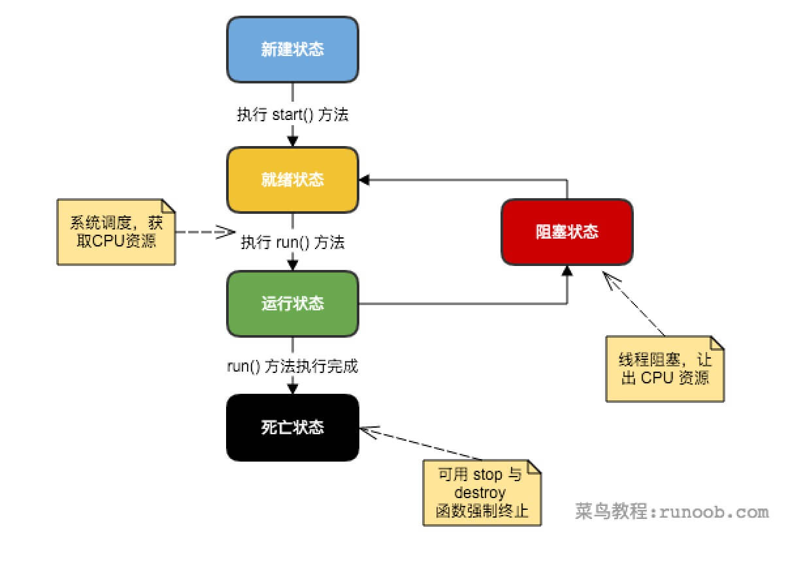

# Java 多线程编程

Java给多线程编程提供了内置的支持。一个多线程程序包含两个或多个能并发运行的部分。程序的每一部分都称作一个线程，并且每个线程定义了一个独立的执行路径。

多线程是多任务的一种特别的形式，但多线程使用了更小的资源开销。

这里定义和线程相关的另一个术语 - 进程：一个进程包括由操作系统分配的内存空间，包含一个或多个线程。一个线程不能独立的存在，它必须是进程的一部分。一个进程一直运行，直到所有的非守候线程都结束运行后才能结束。

多线程能满足程序员编写高效率的程序来达到充分利用CPU的目的。

## 一个线程的生命周

线程经过其生命周期的各个阶段。下图显示了一个线程完整的生命周期。



- **新建状态:**使用 **new** 关键字和 **Thread** 类或其子类建立一个线程对象后，该线程对象就处于新建状态。它保持这个状态直到程序 **start()** 这个线程。
- **就绪状态:**当线程对象调用了start()方法之后，该线程就进入就绪状态。就绪状态的线程处于就绪队列中，要等待JVM里线程调度器的调度。
- **运行状态:**如果就绪状态的线程获取 CPU 资源，就可以执行 **run()**，此时线程便处于运行状态。处于运行状态的线程最为复杂，它可以变为阻塞状态、就绪状态和死亡状态。
- **阻塞状态:**如果一个线程执行了sleep（睡眠）、suspend（挂起）等方法，失去所占用资源之后，该线程就从运行状态进入阻塞状态。在睡眠时间已到或获得设备资源后可以重新进入就绪状态。
- **死亡状态:**一个运行状态的线程完成任务或者其他终止条件发生时，该线程就切换到终止状态。

## 线程的优先级

每一个Java线程都有一个优先级，这样有助于操作系统确定线程的调度顺序。

Java线程的优先级是一个整数，其取值范围是1 （Thread.MIN_PRIORITY ） - 10 （Thread.MAX_PRIORITY ）。

默认情况下，每一个线程都会分配一个优先级NORM_PRIORITY（5）。

具有较高优先级的线程对程序更重要，并且应该在低优先级的线程之前分配处理器资源。但是，线程优先级不能保证线程执行的顺序，而且非常依赖于平台。

## 创建一个线程

Java提供了两种创建线程方法：

- 通过实现Runable接口；
- 通过继承Thread类本身。

## 通过实现Runnable接口来创建线程

创建一个线程，最简单的方法是创建一个实现Runnable接口的类。

为了实现Runnable，一个类只需要执行一个方法调用run()，声明如下：

```java
public void run()
```

你可以重写该方法，重要的是理解的run()可以调用其他方法，使用其他类，并声明变量，就像主线程一样。

在创建一个实现Runnable接口的类之后，你可以在类中实例化一个线程对象。

Thread定义了几个构造方法，下面的这个是我们经常使用的：

```java
Thread(Runnable threadOb,String threadName);
```

这里，threadOb 是一个实现Runnable 接口的类的实例，并且 threadName指定新线程的名字。

新线程创建之后，你调用它的start()方法它才会运行。

```java
void start();
```

### 实例

下面是一个创建线程并开始让它执行的实例：

```java
// 创建一个新的线程
class NewThread implements Runnable {
   Thread t;
   NewThread() {
      // 创建第二个新线程
      t = new Thread(this, "Demo Thread");
      System.out.println("Child thread: " + t);
      t.start(); // 开始线程
   }
  
   // 第二个线程入口
   public void run() {
      try {
         for(int i = 5; i > 0; i--) {
            System.out.println("Child Thread: " + i);
            // 暂停线程
            Thread.sleep(50);
         }
     } catch (InterruptedException e) {
         System.out.println("Child interrupted.");
     }
     System.out.println("Exiting child thread.");
   }
}
 
public class ThreadDemo {
   public static void main(String args[]) {
      new NewThread(); // 创建一个新线程
      try {
         for(int i = 5; i > 0; i--) {
           System.out.println("Main Thread: " + i);
           Thread.sleep(100);
         }
      } catch (InterruptedException e) {
         System.out.println("Main thread interrupted.");
      }
      System.out.println("Main thread exiting.");
   }
}
```

编译以上程序运行结果如下：

```
Child thread: Thread[Demo Thread,5,main]
Main Thread: 5
Child Thread: 5
Child Thread: 4
Main Thread: 4
Child Thread: 3
Child Thread: 2
Main Thread: 3
Child Thread: 1
Exiting child thread.
Main Thread: 2
Main Thread: 1
Main thread exiting.
```

## 通过继承Thread来创建线程

创建一个线程的第二种方法是创建一个新的类，该类继承Thread类，然后创建一个该类的实例。

继承类必须重写run()方法，该方法是新线程的入口点。它也必须调用start()方法才能执行。

### 实例

```java
// 通过继承 Thread 创建线程
class NewThread extends Thread {
   NewThread() {
      // 创建第二个新线程
      super("Demo Thread");
      System.out.println("Child thread: " + this);
      start(); // 开始线程
   }
 
   // 第二个线程入口
   public void run() {
      try {
         for(int i = 5; i > 0; i--) {
            System.out.println("Child Thread: " + i);
                            // 让线程休眠一会
            Thread.sleep(50);
         }
      } catch (InterruptedException e) {
         System.out.println("Child interrupted.");
      }
      System.out.println("Exiting child thread.");
   }
}
 
public class ExtendThread {
   public static void main(String args[]) {
      new NewThread(); // 创建一个新线程
      try {
         for(int i = 5; i > 0; i--) {
            System.out.println("Main Thread: " + i);
            Thread.sleep(100);
         }
      } catch (InterruptedException e) {
         System.out.println("Main thread interrupted.");
      }
      System.out.println("Main thread exiting.");
   }
}
```

编译以上程序运行结果如下：

```
Child thread: Thread[Demo Thread,5,main]
Main Thread: 5
Child Thread: 5
Child Thread: 4
Main Thread: 4
Child Thread: 3
Child Thread: 2
Main Thread: 3
Child Thread: 1
Exiting child thread.
Main Thread: 2
Main Thread: 1
Main thread exiting.
```

## Thread 方法

下表列出了Thread类的一些重要方法：

| **序号** | **方法描述**                                 |
| ------ | ---------------------------------------- |
| 1      | **public void start()**使该线程开始执行；**Java** 虚拟机调用该线程的 run 方法。 |
| 2      | **public void run()**如果该线程是使用独立的 Runnable 运行对象构造的，则调用该 Runnable 对象的 run 方法；否则，该方法不执行任何操作并返回。 |
| 3      | **public final void setName(String name)**改变线程名称，使之与参数 name 相同。 |
| 4      | **public final void setPriority(int priority)** 更改线程的优先级。 |
| 5      | **public final void setDaemon(boolean on)**将该线程标记为守护线程或用户线程。 |
| 6      | **public final void join(long millisec)**等待该线程终止的时间最长为 millis 毫秒。 |
| 7      | **public void interrupt()**中断线程。         |
| 8      | **public final boolean isAlive()**测试线程是否处于活动状态。 |

测试线程是否处于活动状态。 上述方法是被Thread对象调用的。下面的方法是Thread类的静态方法。

| **序号** | **方法描述**                                 |
| ------ | ---------------------------------------- |
| 1      | **public static void yield()**暂停当前正在执行的线程对象，并执行其他线程。 |
| 2      | **public static void sleep(long millisec)**在指定的毫秒数内让当前正在执行的线程休眠（暂停执行），此操作受到系统计时器和调度程序精度和准确性的影响。 |
| 3      | **public static boolean holdsLock(Object x)**当且仅当当前线程在指定的对象上保持监视器锁时，才返回 true。 |
| 4      | **public static Thread currentThread()**返回对当前正在执行的线程对象的引用。 |
| 5      | **public static void dumpStack()**将当前线程的堆栈跟踪打印至标准错误流。 |

### 实例

如下的ThreadClassDemo 程序演示了Thread类的一些方法：

```java
// 文件名 : DisplayMessage.java
// 通过实现 Runnable 接口创建线程
public class DisplayMessage implements Runnable
{
   private String message;
   public DisplayMessage(String message)
   {
      this.message = message;
   }
   public void run()
   {
      while(true)
      {
         System.out.println(message);
      }
   }
}
```

```java
// 文件名 : GuessANumber.java
// 通过继承 Thread 类创建线程

public class GuessANumber extends Thread
{
   private int number;
   public GuessANumber(int number)
   {
      this.number = number;
   }
   public void run()
   {
      int counter = 0;
      int guess = 0;
      do
      {
          guess = (int) (Math.random() * 100 + 1);
          System.out.println(this.getName()
                       + " guesses " + guess);
          counter++;
      }while(guess != number);
      System.out.println("** Correct! " + this.getName()
                       + " in " + counter + " guesses.**");
   }
}
```

```java
// 文件名 : ThreadClassDemo.java
public class ThreadClassDemo
{
   public static void main(String [] args)
   {
      Runnable hello = new DisplayMessage("Hello");
      Thread thread1 = new Thread(hello);
      thread1.setDaemon(true);
      thread1.setName("hello");
      System.out.println("Starting hello thread...");
      thread1.start();
     
      Runnable bye = new DisplayMessage("Goodbye");
      Thread thread2 = new Thread(bye);
      thread2.setPriority(Thread.MIN_PRIORITY);
      thread2.setDaemon(true);
      System.out.println("Starting goodbye thread...");
      thread2.start();
 
      System.out.println("Starting thread3...");
      Thread thread3 = new GuessANumber(27);
      thread3.start();
      try
      {
         thread3.join();
      }catch(InterruptedException e)
      {
         System.out.println("Thread interrupted.");
      }
      System.out.println("Starting thread4...");
      Thread thread4 = new GuessANumber(75);
     
           thread4.start();
      System.out.println("main() is ending...");
   }
}
```

运行结果如下，每一次运行的结果都不一样。

```
Starting hello thread...
Starting goodbye thread...
Hello
Hello
Hello
Hello
Hello
Hello
Hello
Hello
Hello
Thread-2 guesses 27
Hello
** Correct! Thread-2 in 102 guesses.**
Hello
Starting thread4...
Hello
Hello
..........remaining result produced.
```

## 线程的几个主要概念:

在多线程编程时，你需要了解以下几个概念：

- 线程同步
- 线程间通信
- 线程死锁
- 线程控制：挂起、停止和恢复

## 多线程的使用

有效利用多线程的关键是理解程序是并发执行而不是串行执行的。例如：程序中有两个子系统需要并发执行，这时候就需要利用多线程编程。

通过对多线程的使用，可以编写出非常高效的程序。不过请注意，如果你创建太多的线程，程序执行的效率实际上是降低了，而不是提升了。

请记住，上下文的切换开销也很重要，如果你创建了太多的线程，CPU花费在上下文的切换的时间将多于执行程序的时间！

---

# 面试向：同步原语、线程池与 JUC

以上是线程基础；面试高频的"并发深水区"集中在 `synchronized`、`volatile`、线程池与 JUC 工具链，本节按机制补齐。

## synchronized：锁升级

- `synchronized` 保证**互斥**与**可见性**（释放锁前的写对下一个持锁者可见）：既排他，又隐含内存屏障。
- 三种形态：同步实例方法（锁 `this`）、静态方法（锁 `Class` 对象）、同步代码块（锁指定对象）。
- **锁升级（JDK 6+）**，从轻到重、不可逆地逐级发生：
  1. **偏向锁**：无竞争时在对象头记录线程 ID，下次同线程进入几乎零开销（适合单线程反复进入锁）。
  2. **轻量级锁**：出现第二个线程竞争时，CAS 尝试把锁记录到栈帧，自旋等待（不挂起线程，适合临界区极短、竞争不激烈的场景）。
  3. **重量级锁**：自旋超过阈值/竞争激烈 → 操作系统互斥量挂起线程，涉及用户态/内核态切换，开销大。
- JDK 15+ 默认关闭偏向锁（现代应用竞争更普遍，偏向锁收益下降）；JDK 18+ 进一步调整。面试答"锁升级"时点出**动机（减少无竞争开销）与代价（升级不可逆、轻量级自旋浪费 CPU）**即可。
- 字节码层面：`monitorenter`/`monitorexit`，编译器还会生成异常路径上的 `exit` 保证解锁。

**面试追问：`synchronized` 和 `Lock`（ReentrantLock）怎么选？** → 简单互斥优先 `synchronized`（自动释放、不会死锁在忘 unlock、JVM 优化成熟）；需要可中断获取、超时、公平锁、多条件（`Condition`）、读写分离时用 `ReentrantLock`。

## volatile：可见性与禁止重排

- `volatile` 保证两件事：**可见性**（写立即刷回主存，读直接读主存最新值）与**有序性**（禁止指令重排，以内存屏障实现）。
- **不保证原子性**：`volatile int i; i++` 仍是读-改-写三步，并发下丢更新——`i++` 要原子就用 `AtomicInteger` 或加锁。
- 典型应用：状态标志（`volatile boolean running`）、**双重检查锁定（DCL）单例**中 `instance` 字段必须 volatile（防止半初始化对象逃逸：对象构造被重排到引用赋值之后）。
- 与 `final`、`synchronized` 的关系：锁的释放/获取自带可见性语义；Happens-Before 规则中"volatile 写先于后续读"是推理并发代码的基础。

**面试追问：为什么 DCL 的单例字段要 volatile？** → `new` 对象分三步：分配内存、初始化字段、引用赋值。若 2、3 步重排，另一线程可能拿到"已赋值但未初始化"的对象；volatile 禁止这种重排并保证写前写后的操作不越界。

## 线程池：七大参数与 shutdown 语义

`ThreadPoolExecutor` 七大参数（必须背得出、讲得清协作）：

| 参数 | 含义 |
| ---- | ---- |
| `corePoolSize` | 核心线程数（即使空闲也保留，除非 allowCoreThreadTimeOut） |
| `maximumPoolSize` | 最大线程数 |
| `keepAliveTime` + `unit` | 非核心线程空闲存活时间 |
| `workQueue` | 任务队列（`LinkedBlockingQueue`/`ArrayBlockingQueue`/`SynchronousQueue`） |
| `threadFactory` | 线程创建工厂（命名、daemon、UncaughtExceptionHandler） |
| `handler` | 拒绝策略：`AbortPolicy`（默认抛异常）、`CallerRunsPolicy`（提交线程自己跑，反压）、`DiscardPolicy`、`DiscardOldestPolicy` |

**任务提交流程**（面试必画的图）：

1. 当前线程数 < corePoolSize → 创建核心线程执行。
2. 否则任务入队（`workQueue`）。
3. 队列满 → 创建线程直到 maximumPoolSize。
4. 达到 max 且队列仍满 → 走拒绝策略。

注意**先入队、后扩到 max**：`LinkedBlockingQueue` 无界时永远不会扩到 max 线程——线程池失控的经典原因。`newFixedThreadPool`/`newCachedThreadPool` 的无界队列/无界线程是反面教材，生产应显式 `new ThreadPoolExecutor(...)`。

**shutdown 语义**：

- `shutdown()`：**温和**——不再接受新任务，已提交的继续执行完，之后线程终止。
- `shutdownNow()`：**强制**——中断正在执行的任务、清空队列、返回未执行任务列表；执行中任务对中断响应后退出。
- 二者都只调用一次后幂等；配合 `awaitTermination(timeout)` 等待收尾。**不调用 shutdown 会导致线程泄漏**（非 daemon 线程阻止 JVM 退出）。

## JUC 工具速览（面试选答）

- **`Atomic*` / `LongAdder`**：CAS 无锁计数；高并发计数用 `LongAdder`（分段累加，读时求和），`AtomicLong` 在高竞争下 CAS 自旋成为瓶颈。
- **AQS（AbstractQueuedSynchronizer）**：`ReentrantLock`、`Semaphore`、`CountDownLatch` 的共同内核——`volatile int state` 表示资源状态 + CLH 变体的双向等待队列 + 条件队列（`Condition`）。加锁失败入队 park，解锁时 unpark 队首。
- **`ReentrantReadWriteLock`**：读共享写独占，适合读多写少；写线程饥饿与降级（写锁内可再拿读锁）是追问点。
- **`CountDownLatch`**（等 N 个事件，一次性）、`CyclicBarrier`（多线程互相等，可重用）、`Semaphore`（许可数控制并发度）。
- **`ConcurrentHashMap`**：见 [ConcurrentHashMap](../DataStructure/ConcurrentHashMap.md)。

## 线程安全的三个层次（收束）

1. **不可变**（`final`、不可变对象、`String`）：无共享可写状态，最可靠。
2. **互斥**：`synchronized`/`Lock`/线程池隔离——把共享变量关进临界区。
3. **无锁**：CAS/原子类/并发容器——用硬件指令替代锁，适合短小更新。

选型口诀：**能不可变就不可变，能并发容器就不裸用集合，必须共享可变才上锁**。

## 【面试追问链】

1. **`synchronized` 可重入吗、怎么实现的？** → 可重入（同一线程可重复获取）；每个锁对象头/栈帧记录重入计数，`monitorexit` 递减到 0 才真正释放——否则嵌套同步方法会自死锁。
2. **volatile 能替代锁吗？** → 不能。它只管可见性与有序性，`i++` 类复合操作仍非原子；"volatile 适合写多读少的标志位，不适合计数与复合更新"是标准边界。
3. **线程池线程数怎么定？** → CPU 密集 ≈ 核数+1；IO 密集 ≈ 核数 × (1 + 等待时间/计算时间)，经验公式后必须压测；同时给队列设界，让拒绝策略真实生效。
4. **`CallerRunsPolicy` 的副作用？** → 反压有效但会拖慢提交线程；若提交线程是 Tomcat 的 IO 线程，可能拖垮整个 Web 层——用它要想清楚谁在承担过载。
5. **`ThreadPoolExecutor` 的 core 和 max 在空闲时如何缩容？** → 非核心线程空闲超 keepAlive 后回收；core 线程默认不回收，`allowCoreThreadTimeOut(true)` 可让它们同样受超时控制。
6. **线程池里提交的 Runnable 抛异常会怎样？** → 线程终止并被替换（池内线程是可复用工作线程，异常不会杀死整个池）；未捕获异常经 `afterExecute`/`UncaughtExceptionHandler` 处理，任务从队列消失——务必在任务内部 try-catch 或设置处理器，否则异常静默丢失。
