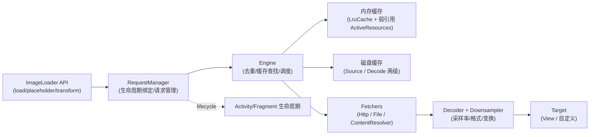
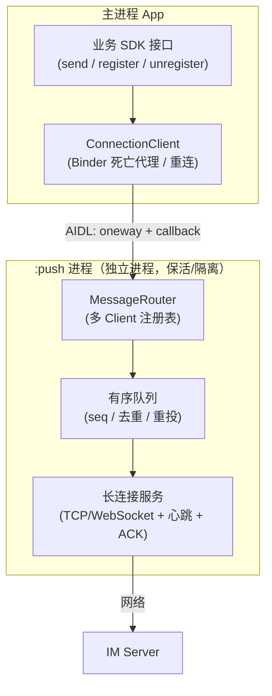

# 第1页 · 系统设计（一）

## 题目1：设计一个图片加载库（对标 Glide / Coil / Fresco）

### 问题

请从零设计一个生产级 Android 图片加载库：支持 URL/本地资源加载、多级缓存、生命周期感知、变换（圆角/模糊）、占位图与错误图。你会怎么设计？

### 模块图

### 机制级答案

- **请求生命周期与去重**：`RequestManager` 挂到 `Lifecycle`（Fragment/Activity 的 lifecycle，或 Glide 时代的 `RequestManagerRetriever` + 无界面 Fragment），页面 `onStop` 暂停、`onDestroy` 取消。同一 Key（URL+尺寸+变换）的并发请求在 Engine 层去重，多个 Target 共享一个进行中的 `EngineJob`，完成时广播结果——这是列表快速滑动时不重复下载/解码的关键。
- **多级缓存**：
  - 内存：两级——`ActiveResources`（弱引用，正在使用中的图，避免被 LRU 立刻逐出导致正在显示的图再读盘）+ `LruCache`（按 size 逐出，size 通常按每像素字节数估算）。
  - 磁盘：`SOURCE` 缓存原始字节、`DATA` 缓存解码+变换后的结果；命中 DATA 可跳过网络和重解码。缓存 Key 必须包含：原始标识（URL/Id）、宽高、变换、解码配置、版本号。
- **尺寸与采样**：Target 的 `getSize` 在 `View` 未测量完成前挂起（`SizeReadyCallback`），拿到目标像素尺寸后传给 Downsampler 计算 `inSampleSize`（2 的幂），避免把 4000×3000 的图全量解码进内存再缩放。
- **主线程纪律**：网络 IO、磁盘 IO、解码全部在后台线程池；主线程只做缓存命中时的同步 setBitmap + invalidate。Bitmap 复用（`inBitmap` / BitmapPool）降低分配与 GC 压力。
- **错误与占位**：状态机 `PENDING → RUNNING → SUCCEEDED/FAILED/CLEARED`；placeholder 在请求发起时同步设置，error 在失败路径设置，cleared 时恢复占位并释放资源。

### 【为什么这样设计】

- 生命周期感知解决「Activity 泄漏 + 回来后设置到已销毁 View」两大事故；请求去重解决列表场景重复 IO；两级内存缓存解决「正在显示」与「最近使用」的驱逐冲突；采样解码解决 OOM 的主因（全分辨率解码）。每个设计几乎都对应一个线上事故类型——面试时能把「设计」与「事故」挂钩即为加分。

### 【面试官视角：考察点 / 加分 / 减分】

- 考察点：缓存 Key 的完备性、生命周期、线程模型、内存预算、可扩展性（自定义 model/loader）。
- 加分：提到 ActiveResources 的存在意义；提到 inBitmap/BitmapPool 与 4.4 前后 API 差异；提到磁盘缓存上限与 app 缓存目录（外部 cache 可被系统清）；给出容量估算（如：头像 1080×135×ARGB8888 ≈ 580KB，LRU 设 64MB ≈ 同时缓存 ~110 张）。
- 减分：只背 Glide 类名说不清 Engine 去重；把网络缓存与磁盘缓存混为一谈；主张所有图都缓存原始尺寸而不采样。

### 【追问链】

1. 为什么列表中同一个 URL 不同尺寸要分别缓存解码结果？→ DATA 缓存 Key 含尺寸；SOURCE 不含。
2. 你如何支持 GIF/WebP 动图？→ 独立 Decoder + 逐帧解码 + 帧调度，内存策略改为「帧缓冲 + 单帧缓存」。
3. 如何做图片库的「预加载」与「优先级」？→ 请求队列优先级 + 页面闲时 prefetch 到 SOURCE/DATA 缓存。

---

## 题目2：设计一个跨进程 IM 消息通道（对标推送 / 聊天 SDK 的连接层）

### 问题

App 内有一个独立进程的 `:push` 进程维护长连接，主进程所有业务要通过它收发 IM 消息。请设计这条跨进程消息通道。

### 模块图

### 机制级答案

- **为什么独立进程**：长连接进程崩溃/被杀不连带主进程 UI；主进程退出后推送进程可独立存活（配合前台服务/厂商通道策略）；内存隔离，推送协议栈 OOM 不拖垮业务。代价是跨进程通信成本与复杂度，所以接口必须**批量、异步、少回调嵌套**。
- **Binder 接口设计**：Client → Server 用 `oneway` 避免主线程被远端阻塞；Server → Client 用注册的 `IMessageCallback`（同样是 oneway）回调。必须处理 `DeathRecipient`（`linkToDeath`）：推送进程死了要感知并重绑；反过来推送进程维护 clientId → callback 的注册表，主进程死了（binderDied）要清理，防泄漏。**不要用 Messenger 模拟复杂路由**——它只有串行单线程语义，吞吐与多路复用不够。
- **消息可靠性（端到端）**：服务端消息带单调 `seq`；通道层维护「已确认窗口」，ACK 超时重推；客户端按 seq 去重（滑动窗口 + 位图）。跨进程只是通道的一段：主进程收到后要本地落库（DB），再业务消费——「收到」与「业务处理成功」分开 ACK，避免进程间 ack 丢失造成重复或丢单。
- **心跳与重连**：应用层心跳（间隔 = min(服务端超时, NAT 典型 idle)，如 4.5min 以内），指数退避 + 抖动重连；切换网络（wifi↔蜂窝）重建连接。进程存活期间用前台 Service 或绑定保活策略维持，但**不能把正确性建立在保活上**——重连与拉取离线消息才是兜底。
- **有序与并发**：单连接内用发送队列串行化 + seq；上行要有本地时间戳与服务端接收时间双字段，解决乱序归因。进程内多 Client 对同一连接的写操作必须经 Router 单点串行，避免交织。

### 【为什么这样设计】

- 进程边界 = 稳定性边界 + 权限边界，但引入 IPC 一等公民问题（死亡、重连、序列化、多路复用）；因此设计原则是「**边界处少而粗、内部细而快**」：跨进程接口只暴露注册/发送/批量拉取，不暴露细粒度控制面。
- ACK 分层：传输层 ACK（进程↔服务端）与业务层 ACK（业务消费成功）分离，是对「分布式系统双写」问题的标准分解。

### 【面试官视角：考察点 / 加分 / 减分】

- 考察点：Binder 语义（oneway、DeathRecipient）、多进程状态同步、可靠投递的分层 ACK、NAT/心跳常识。
- 加分：能画出「发送队列 + seq 去重窗口」；提到 binder 线程池默认并发限制与耗时调用禁止；提到厂商通道（华为/小米/OPPO/vivo）与自建长连接的互补关系及「厂商通道到达率高但下行时机受限」。
- 减分：把 Messenger 当成万能方案；宣称「bindService 就不会死」；无 ACK、无去重就谈「不丢消息」。
