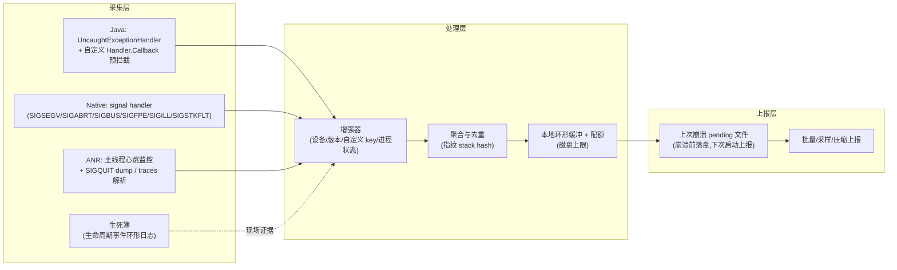
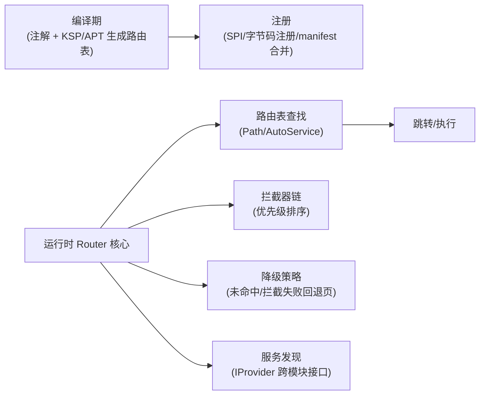

# 第2页 · 系统设计（二）

## 题目3：设计崩溃 + ANR 监控 SDK

### 问题

为线上 App 设计一套崩溃与 ANR 监控 SDK：Java 异常、Native crash、ANR 都要覆盖，崩溃后能定位堆栈与现场，还要能支撑大盘聚合、报警与灰度。怎么设计？

### 模块图

### 机制级答案

- **Java 崩溃采集**：`Thread.setDefaultUncaughtExceptionHandler`。要点：① 先记生死簿、落盘，再**回调系统默认 handler**（交还给 AMS 处理，保证系统弹窗/杀进程语义正确——不要吞掉异常后自行 `Process.killProcess` 了事）；② 自定义 `Handler.Callback` / `Looper.loop` 拦截可把「可恢复的」业务异常与致命崩溃分流（需评估与系统语义冲突）；③ 子线程未捕获异常同样走 default handler，但线程池里的任务异常应由 `afterExecute`/`Future.get` 显式收集，不能依赖全局兜底。
- **Native crash 采集**：注册关键信号的 handler（SA_SIGINFO + SA_ONSTACK，用 `sigaltstack` 保证栈溢出类信号也有独立栈可用）。崩溃上下文里只做**异步信号安全**的事：写预分配缓冲/`write` 到 fd，然后写 pending 文件；backtrace 的展开（dwarf/eh_frame unwind）与符号化放到**下次启动的独立进程/独立线程**做，这是 Breakpad/Crashpad 的核心思路（异常快照 + 异步处理），handler 内分配内存/加锁会二次崩溃。Android 上 tombstone 由系统 debuggerd 处理，自研 SDK 仍需自己拿到 native 栈才能归因到 so 行。
- **ANR 采集**：ANR 是系统行为（InputDispatcher 5s / 广播/服务超时等），应用侧无法「捕获」，只能**预测 + 事后归因**：
  - 主线程心跳：子线程定期 post 到主线程一个 Runnable，测量其执行间隔；连续超阈值（如 >5s 无心跳回包）判定疑似卡顿/ANR，采样主线程栈 + 当前消息（`Looper` 消息日志开启 `logging` 可拿到分发中的 msg）。
  - 事后归因：进程还活着时主动 dump 主线程栈；已死则读系统 traces（`/data/anr/traces.txt` 路径随版本变化，Android 高版本需注意权限）或从 DropBox/SystemLog 侧（厂商/系统能力）旁证。
  - 死因判定：心跳超时 + 上报时带「ANR 窗口前后的主线程栈采样」，避免只有一句"ANR in xxx"无法归因。
- **生死簿（Becoming Book / lifecycle journal）**：内存环形缓冲记录最近 N 条关键事件：生命周期、`Application.onCreate` 各阶段耗时、最近主线程消息（what/target/耗时）、最近网络请求、最近页面路由。崩溃/ANR 触发时把环形缓冲一并落盘。**价值**：崩溃堆栈告诉你"死在哪"，生死簿告诉你"死前在做什么"——对 Native 死因不明、死在 `libc`/`malloc` 内部的 case 是唯一线索。
- **聚合与上报**：崩溃指纹 = 堆栈规范化后 hash（去行号/去内联中间层可配置）；本地磁盘配额与去重防打爆存储；上报走独立低优先级通道，**先落盘后启动补报**；关键崩溃（新增指纹/全网 TOP）实时，长尾采样。

### 【为什么这样设计】

- 监控 SDK 是「运行在最坏路径上的代码」：崩溃 handler 里任何分配、锁、复杂 IO 都可能制造新事故 → 快照+异步处理是铁律。
- ANR 的系统判定与应用感知存在信息差（系统判定在 framework/input 层），应用侧只能逼近 → 心跳预测 + 栈采样 + 生死簿三方交叉，是工业界（如 Matrix/快手 Koom 生态、字节 btrace 类思路）的公约数。
- 大盘可运营的前提是**指纹化**：不聚合就没有报警阈值，没有阈值就没有治理节奏。

### 【面试官视角：考察点 / 加分 / 减分】

- 考察点：信号安全、handler 链、系统语义（为何交还默认 handler）、ANR 成因分类、崩溃数据治理。
- 加分：区分 Java 崩溃/OOM/ANR/WatchDog/Silent 异常；提到主线程 Looper logging 定位慢消息；提到 native 需要保存 maps/内存快照辅助分析 use-after-free；给出指标口径（见 Stability 第2页）。
- 减分：handler 里直接做网络上报；`Runtime.halt` 自杀式处理；声称能"完全防止 ANR"。

### 【追问链】

1. 如何监控子线程卡死？→ 任务包裹 + 完成超时检测，或 watchdog 对关键 Worker 心跳。
2. 如何避免崩溃风暴（崩溃→重启→崩溃）打爆流量？→ 指纹去重 + 设备级/会话级配额 + 崩溃次数分级（N 次内不重复详报）。
3. 如何定位 Native 内存踩踏而非崩溃点？→ 生死簿 + malloc hook/采样（Koom/heimdall 类思路）+ 明细 dump 对比。

---

## 题目4：设计组件化路由框架（对标 ARouter）

### 问题

App 拆成数十个业务 module 后，如何跨模块打开页面、调用服务、做登录拦截与降级？请设计一个路由框架。

### 模块图

### 机制级答案

- **编译期收集**：`@Route(path="/user/profile")` 注解 → KSP/APT 生成 `IRouteGroup` 类；避免运行时反射扫 dex（慢且随方法数膨胀）。注册方式三种演进：① 初始化逐 group load；② Gradle Transform/ASM 把 load 调用插桩到统一注册类（ARouter 的 auto-register 思路）；③ `ServiceLoader`/KSP 生成的 Provider（Koin 时代更常见）。目标都是：O(1) 反查 + 初始化耗时可接受。
- **运行时流程**：`build(path) → 拦截器链（按 priority 排序，可异步拦截如登录、地域、灰度）→ 查表拿 RouteMeta（target/type/meta）→ 类型分发（Activity / Fragment / Provider / Action）→ 执行导航（Intent/Fragment Transaction 封装，参数自动注入可用编译期生成的注入类替代手写 getXXX）。**
- **拦截器与降级**：拦截器是责任链，支持异步（回调/协程挂起）；任一拦截标记「终止」则导航结束。降级分两层：**编译期缺失**（目标不存在，模块被裁剪）→ 降级到占位页；**运行期失败**（目标存在但跳转异常）→ 全局 DegradeService。没有降级设计，组件化裁剪/实验分支就是事故源。
- **跨模块服务**：路由不止跳页——`IProvider` 服务接口放 common-api，实现在各业务 module，注册进同一张表；调用方只依赖接口。**业务 module 之间禁止直接依赖实现**，只能：common-api（接口+数据）或 路由（运行时松耦合）。
- **工程治理配套**：路由 path 是跨模块的**公开 API**，要有命名规约（域名/模块/页面）、owner 归属、变更评审；提供编译期校验（path 冲突检测、不存在的 path 在 CI 中静态检查）——路由框架最大的线上事故是**重命名或裁剪模块后跳转 404**。

### 【为什么这样设计】

- 编译期做重活、运行期做轻查：Android 进程启动时间敏感，注册表线性加载会拖慢冷启动。
- 责任链拦截器：登录/灰度/AB 等横切逻辑不能侵入每个跳转调用点，否则调用方会绕过。
- 强降级：组件化的收益（按需组合、并行开发）伴随「组合缺失」风险，路由层是收口点。

### 【面试官视角：考察点 / 加分 / 减分】

- 考察点：APT/KSP 与字节码插桩、解耦边界、拦截器异步语义、API 治理。
- 加分：给出 path 治理流程与 CI 冲突检测；区分 ARouter 与 DeepLink 的共用与差异（外链要鉴权、要白名单，不能直接复用内部全表）；提到组件间数据传递的类型安全演进（Serializable 参数膨胀问题）。
- 减分：运行时 dex 扫描；所有跨模块调用都走路由字符串（失去编译期检查）；没有降级方案。
