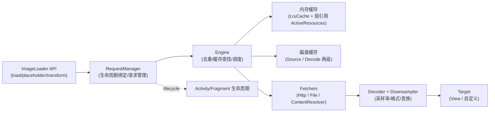
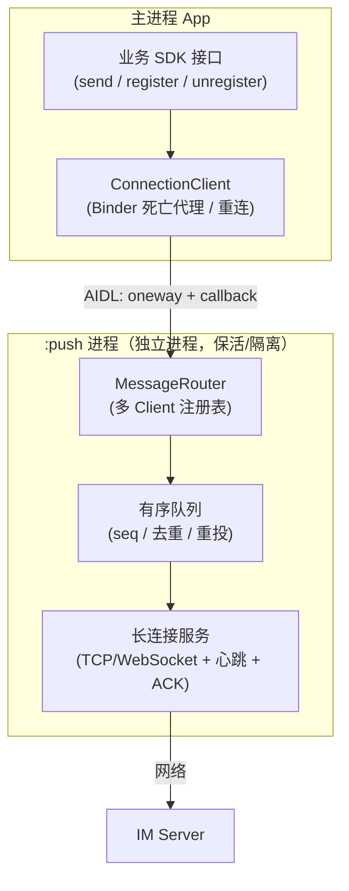
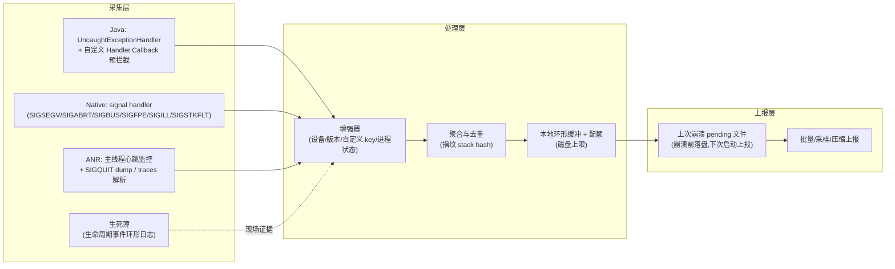
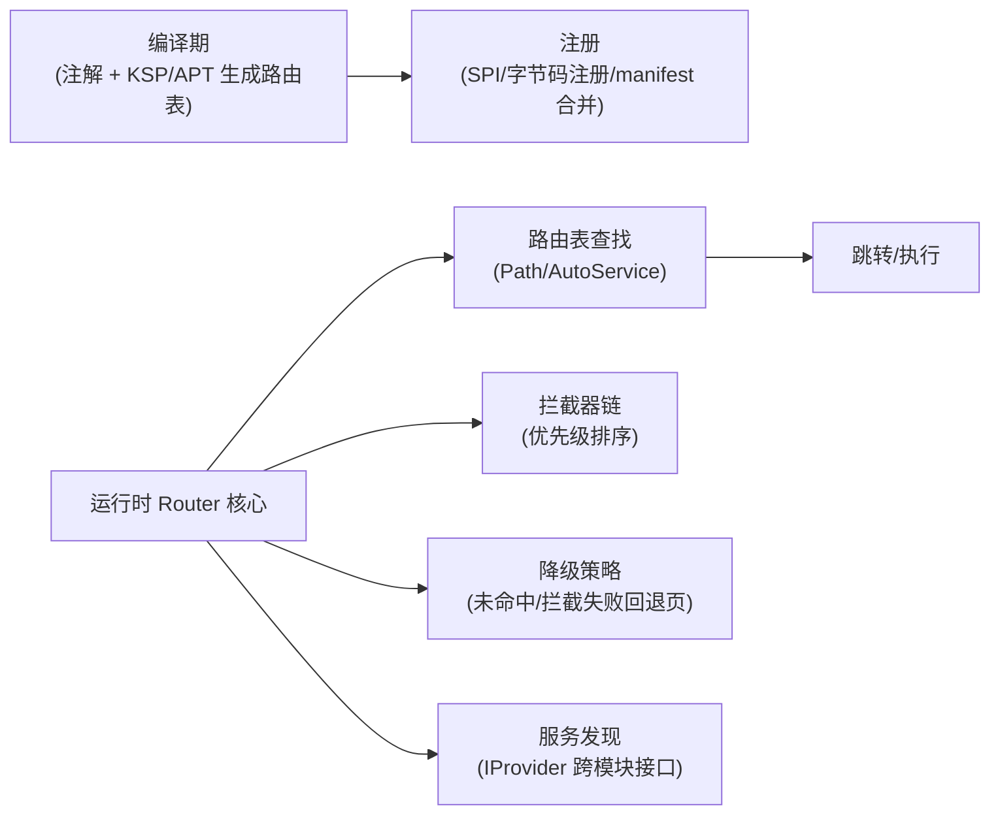

# SystemDesign

## 题目1：设计一个图片加载库（对标 Glide / Coil / Fresco）

### 问题

请从零设计一个生产级 Android 图片加载库：支持 URL/本地资源加载、多级缓存、生命周期感知、变换（圆角/模糊）、占位图与错误图。你会怎么设计？

### 模块图

### 机制级答案

- **请求生命周期与去重**：`RequestManager` 挂到 `Lifecycle`（Fragment/Activity 的 lifecycle，或 Glide 时代的 `RequestManagerRetriever` + 无界面 Fragment），页面 `onStop` 暂停、`onDestroy` 取消。同一 Key（URL+尺寸+变换）的并发请求在 Engine 层去重，多个 Target 共享一个进行中的 `EngineJob`，完成时广播结果——这是列表快速滑动时不重复下载/解码的关键。
- **多级缓存**：
  - 内存：两级——`ActiveResources`（弱引用，正在使用中的图，避免被 LRU 立刻逐出导致正在显示的图再读盘）+ `LruCache`（按 size 逐出，size 通常按每像素字节数估算）。
  - 磁盘：`SOURCE` 缓存原始字节、`DATA` 缓存解码+变换后的结果；命中 DATA 可跳过网络和重解码。缓存 Key 必须包含：原始标识（URL/Id）、宽高、变换、解码配置、版本号。
- **尺寸与采样**：Target 的 `getSize` 在 `View` 未测量完成前挂起（`SizeReadyCallback`），拿到目标像素尺寸后传给 Downsampler 计算 `inSampleSize`（2 的幂），避免把 4000×3000 的图全量解码进内存再缩放。
- **主线程纪律**：网络 IO、磁盘 IO、解码全部在后台线程池；主线程只做缓存命中时的同步 setBitmap + invalidate。Bitmap 复用（`inBitmap` / BitmapPool）降低分配与 GC 压力。
- **错误与占位**：状态机 `PENDING → RUNNING → SUCCEEDED/FAILED/CLEARED`；placeholder 在请求发起时同步设置，error 在失败路径设置，cleared 时恢复占位并释放资源。

### 【为什么这样设计】

- 生命周期感知解决「Activity 泄漏 + 回来后设置到已销毁 View」两大事故；请求去重解决列表场景重复 IO；两级内存缓存解决「正在显示」与「最近使用」的驱逐冲突；采样解码解决 OOM 的主因（全分辨率解码）。每个设计几乎都对应一个线上事故类型——面试时能把「设计」与「事故」挂钩即为加分。

### 【面试官视角：考察点 / 加分 / 减分】

- 考察点：缓存 Key 的完备性、生命周期、线程模型、内存预算、可扩展性（自定义 model/loader）。
- 加分：提到 ActiveResources 的存在意义；提到 inBitmap/BitmapPool 与 4.4 前后 API 差异；提到磁盘缓存上限与 app 缓存目录（外部 cache 可被系统清）；给出容量估算（如：头像 1080×135×ARGB8888 ≈ 580KB，LRU 设 64MB ≈ 同时缓存 ~110 张）。
- 减分：只背 Glide 类名说不清 Engine 去重；把网络缓存与磁盘缓存混为一谈；主张所有图都缓存原始尺寸而不采样。

### 【追问链】

1. 为什么列表中同一个 URL 不同尺寸要分别缓存解码结果？→ DATA 缓存 Key 含尺寸；SOURCE 不含。
2. 你如何支持 GIF/WebP 动图？→ 独立 Decoder + 逐帧解码 + 帧调度，内存策略改为「帧缓冲 + 单帧缓存」。
3. 如何做图片库的「预加载」与「优先级」？→ 请求队列优先级 + 页面闲时 prefetch 到 SOURCE/DATA 缓存。

---

## 题目2：设计一个跨进程 IM 消息通道（对标推送 / 聊天 SDK 的连接层）

### 问题

App 内有一个独立进程的 `:push` 进程维护长连接，主进程所有业务要通过它收发 IM 消息。请设计这条跨进程消息通道。

### 模块图

### 机制级答案

- **为什么独立进程**：长连接进程崩溃/被杀不连带主进程 UI；主进程退出后推送进程可独立存活（配合前台服务/厂商通道策略）；内存隔离，推送协议栈 OOM 不拖垮业务。代价是跨进程通信成本与复杂度，所以接口必须**批量、异步、少回调嵌套**。
- **Binder 接口设计**：Client → Server 用 `oneway` 避免主线程被远端阻塞；Server → Client 用注册的 `IMessageCallback`（同样是 oneway）回调。必须处理 `DeathRecipient`（`linkToDeath`）：推送进程死了要感知并重绑；反过来推送进程维护 clientId → callback 的注册表，主进程死了（binderDied）要清理，防泄漏。**不要用 Messenger 模拟复杂路由**——它只有串行单线程语义，吞吐与多路复用不够。
- **消息可靠性（端到端）**：服务端消息带单调 `seq`；通道层维护「已确认窗口」，ACK 超时重推；客户端按 seq 去重（滑动窗口 + 位图）。跨进程只是通道的一段：主进程收到后要本地落库（DB），再业务消费——「收到」与「业务处理成功」分开 ACK，避免进程间 ack 丢失造成重复或丢单。
- **心跳与重连**：应用层心跳（间隔 = min(服务端超时, NAT 典型 idle)，如 4.5min 以内），指数退避 + 抖动重连；切换网络（wifi↔蜂窝）重建连接。进程存活期间用前台 Service 或绑定保活策略维持，但**不能把正确性建立在保活上**——重连与拉取离线消息才是兜底。
- **有序与并发**：单连接内用发送队列串行化 + seq；上行要有本地时间戳与服务端接收时间双字段，解决乱序归因。进程内多 Client 对同一连接的写操作必须经 Router 单点串行，避免交织。

### 【为什么这样设计】

- 进程边界 = 稳定性边界 + 权限边界，但引入 IPC 一等公民问题（死亡、重连、序列化、多路复用）；因此设计原则是「**边界处少而粗、内部细而快**」：跨进程接口只暴露注册/发送/批量拉取，不暴露细粒度控制面。
- ACK 分层：传输层 ACK（进程↔服务端）与业务层 ACK（业务消费成功）分离，是对「分布式系统双写」问题的标准分解。

### 【面试官视角：考察点 / 加分 / 减分】

- 考察点：Binder 语义（oneway、DeathRecipient）、多进程状态同步、可靠投递的分层 ACK、NAT/心跳常识。
- 加分：能画出「发送队列 + seq 去重窗口」；提到 binder 线程池默认并发限制与耗时调用禁止；提到厂商通道（华为/小米/OPPO/vivo）与自建长连接的互补关系及「厂商通道到达率高但下行时机受限」。
- 减分：把 Messenger 当成万能方案；宣称「bindService 就不会死」；无 ACK、无去重就谈「不丢消息」。

---

## 题目3：设计崩溃 + ANR 监控 SDK

### 问题

为线上 App 设计一套崩溃与 ANR 监控 SDK：Java 异常、Native crash、ANR 都要覆盖，崩溃后能定位堆栈与现场，还要能支撑大盘聚合、报警与灰度。怎么设计？

### 模块图

### 机制级答案

- **Java 崩溃采集**：`Thread.setDefaultUncaughtExceptionHandler`。要点：① 先记生死簿、落盘，再**回调系统默认 handler**（交还给 AMS 处理，保证系统弹窗/杀进程语义正确——不要吞掉异常后自行 `Process.killProcess` 了事）；② 自定义 `Handler.Callback` / `Looper.loop` 拦截可把「可恢复的」业务异常与致命崩溃分流（需评估与系统语义冲突）；③ 子线程未捕获异常同样走 default handler，但线程池里的任务异常应由 `afterExecute`/`Future.get` 显式收集，不能依赖全局兜底。
- **Native crash 采集**：注册关键信号的 handler（SA_SIGINFO + SA_ONSTACK，用 `sigaltstack` 保证栈溢出类信号也有独立栈可用）。崩溃上下文里只做**异步信号安全**的事：写预分配缓冲/`write` 到 fd，然后写 pending 文件；backtrace 的展开（dwarf/eh_frame unwind）与符号化放到**下次启动的独立进程/独立线程**做，这是 Breakpad/Crashpad 的核心思路（异常快照 + 异步处理），handler 内分配内存/加锁会二次崩溃。Android 上 tombstone 由系统 debuggerd 处理，自研 SDK 仍需自己拿到 native 栈才能归因到 so 行。
- **ANR 采集**：ANR 是系统行为（InputDispatcher 5s / 广播/服务超时等），应用侧无法「捕获」，只能**预测 + 事后归因**：
  - 主线程心跳：子线程定期 post 到主线程一个 Runnable，测量其执行间隔；连续超阈值（如 >5s 无心跳回包）判定疑似卡顿/ANR，采样主线程栈 + 当前消息（`Looper` 消息日志开启 `logging` 可拿到分发中的 msg）。
  - 事后归因：进程还活着时主动 dump 主线程栈；已死则读系统 traces（`/data/anr/traces.txt` 路径随版本变化，Android 高版本需注意权限）或从 DropBox/SystemLog 侧（厂商/系统能力）旁证。
  - 死因判定：心跳超时 + 上报时带「ANR 窗口前后的主线程栈采样」，避免只有一句"ANR in xxx"无法归因。
- **生死簿（Becoming Book / lifecycle journal）**：内存环形缓冲记录最近 N 条关键事件：生命周期、`Application.onCreate` 各阶段耗时、最近主线程消息（what/target/耗时）、最近网络请求、最近页面路由。崩溃/ANR 触发时把环形缓冲一并落盘。**价值**：崩溃堆栈告诉你"死在哪"，生死簿告诉你"死前在做什么"——对 Native 死因不明、死在 `libc`/`malloc` 内部的 case 是唯一线索。
- **聚合与上报**：崩溃指纹 = 堆栈规范化后 hash（去行号/去内联中间层可配置）；本地磁盘配额与去重防打爆存储；上报走独立低优先级通道，**先落盘后启动补报**；关键崩溃（新增指纹/全网 TOP）实时，长尾采样。

### 【为什么这样设计】

- 监控 SDK 是「运行在最坏路径上的代码」：崩溃 handler 里任何分配、锁、复杂 IO 都可能制造新事故 → 快照+异步处理是铁律。
- ANR 的系统判定与应用感知存在信息差（系统判定在 framework/input 层），应用侧只能逼近 → 心跳预测 + 栈采样 + 生死簿三方交叉，是工业界（如 Matrix/快手 Koom 生态、字节 btrace 类思路）的公约数。
- 大盘可运营的前提是**指纹化**：不聚合就没有报警阈值，没有阈值就没有治理节奏。

### 【面试官视角：考察点 / 加分 / 减分】

- 考察点：信号安全、handler 链、系统语义（为何交还默认 handler）、ANR 成因分类、崩溃数据治理。
- 加分：区分 Java 崩溃/OOM/ANR/WatchDog/Silent 异常；提到主线程 Looper logging 定位慢消息；提到 native 需要保存 maps/内存快照辅助分析 use-after-free；给出指标口径（见 Stability 第2页）。
- 减分：handler 里直接做网络上报；`Runtime.halt` 自杀式处理；声称能"完全防止 ANR"。

### 【追问链】

1. 如何监控子线程卡死？→ 任务包裹 + 完成超时检测，或 watchdog 对关键 Worker 心跳。
2. 如何避免崩溃风暴（崩溃→重启→崩溃）打爆流量？→ 指纹去重 + 设备级/会话级配额 + 崩溃次数分级（N 次内不重复详报）。
3. 如何定位 Native 内存踩踏而非崩溃点？→ 生死簿 + malloc hook/采样（Koom/heimdall 类思路）+ 明细 dump 对比。

---

## 题目4：设计组件化路由框架（对标 ARouter）

### 问题

App 拆成数十个业务 module 后，如何跨模块打开页面、调用服务、做登录拦截与降级？请设计一个路由框架。

### 模块图

### 机制级答案

- **编译期收集**：`@Route(path="/user/profile")` 注解 → KSP/APT 生成 `IRouteGroup` 类；避免运行时反射扫 dex（慢且随方法数膨胀）。注册方式三种演进：① 初始化逐 group load；② Gradle Transform/ASM 把 load 调用插桩到统一注册类（ARouter 的 auto-register 思路）；③ `ServiceLoader`/KSP 生成的 Provider（Koin 时代更常见）。目标都是：O(1) 反查 + 初始化耗时可接受。
- **运行时流程**：`build(path) → 拦截器链（按 priority 排序，可异步拦截如登录、地域、灰度）→ 查表拿 RouteMeta（target/type/meta）→ 类型分发（Activity / Fragment / Provider / Action）→ 执行导航（Intent/Fragment Transaction 封装，参数自动注入可用编译期生成的注入类替代手写 getXXX）。**
- **拦截器与降级**：拦截器是责任链，支持异步（回调/协程挂起）；任一拦截标记「终止」则导航结束。降级分两层：**编译期缺失**（目标不存在，模块被裁剪）→ 降级到占位页；**运行期失败**（目标存在但跳转异常）→ 全局 DegradeService。没有降级设计，组件化裁剪/实验分支就是事故源。
- **跨模块服务**：路由不止跳页——`IProvider` 服务接口放 common-api，实现在各业务 module，注册进同一张表；调用方只依赖接口。**业务 module 之间禁止直接依赖实现**，只能：common-api（接口+数据）或 路由（运行时松耦合）。
- **工程治理配套**：路由 path 是跨模块的**公开 API**，要有命名规约（域名/模块/页面）、owner 归属、变更评审；提供编译期校验（path 冲突检测、不存在的 path 在 CI 中静态检查）——路由框架最大的线上事故是**重命名或裁剪模块后跳转 404**。

### 【为什么这样设计】

- 编译期做重活、运行期做轻查：Android 进程启动时间敏感，注册表线性加载会拖慢冷启动。
- 责任链拦截器：登录/灰度/AB 等横切逻辑不能侵入每个跳转调用点，否则调用方会绕过。
- 强降级：组件化的收益（按需组合、并行开发）伴随「组合缺失」风险，路由层是收口点。

### 【面试官视角：考察点 / 加分 / 减分】

- 考察点：APT/KSP 与字节码插桩、解耦边界、拦截器异步语义、API 治理。
- 加分：给出 path 治理流程与 CI 冲突检测；区分 ARouter 与 DeepLink 的共用与差异（外链要鉴权、要白名单，不能直接复用内部全表）；提到组件间数据传递的类型安全演进（Serializable 参数膨胀问题）。
- 减分：运行时 dex 扫描；所有跨模块调用都走路由字符串（失去编译期检查）；没有降级方案。

---

本页不新增题目，而是把前面三道系统设计题抽象成**可复用的答题骨架**——百万年薪面试里，系统设计考的从来不是"背出某个库的类名"，而是：**边界感、量化估算、故障思维、演进路线**。

## 一、15 秒定界（先问清再开口）

开场用 3~5 个问题收窄范围，体现工程判断力：

- **规模**：DAU / 峰值 QPS / 单条消息大小 / 图片分辨率分布——决定缓存与队列容量。
- **一致性要求**：消息能否丢、能否重、能否乱序展示——决定 ACK 分层与去重设计。
- **端上约束**：最低 API Level、内存档位（低端机占比）、后台限制（厂商通道/保活现实）。
- **团队与演进**：从零设计还是已有系统改造——决定是否谈迁移路径。

> 示例话术："这个图片库是公司级通用库还是要支撑特定业务场景？图片以头像/UGC 大图为主还是信息流瀑布流为主？我按信息流场景 + 中低端机占比 40% 来设计。"

## 二、容量估算（设计题的"算法题"）

估算不是背公式，是展示**数量级直觉**。常用推演：

- **图片库内存**：ARGB_8888 每像素 4 字节。1080×1350 头像 ≈ 5.8MB；LRU 64MB ≈ 同时驻留 ~110 张。列表滑动中可见页 8 张 × 2（解码+显示）+ Active 余量 → 反推 LRU 预算 = maxMemory 的 1/8 量级再压测。
- **IM 通道消息量**：单连接心跳 4.5min 一次 ≈ 每设备每天 ~320 次心跳；万人在线推送窗口峰值估"每秒下行条数 = 在线数 × 广播频率"，端上要做**合并与丢弃策略**（过期的会话更新直接合并）。
- **监控 SDK 流量**：崩溃 ~5-20KB/条（含 mini-dump 可到数百 KB），日崩溃设备占比 ~0.5%-2%（大盘量级），按指纹去重 + 采样后上报量 = 设备数 × 崩溃率 × 采样率 × 去重系数。能给出这个乘法链条即为加分。

## 三、稳定性设计清单（每个系统设计题都要主动讲）

1. **边界防御**：跨进程/跨网络的每一个接口假设它会死、会慢、会重复。
2. **降级路径**：核心链路之外的一切（路由未命中、推送进程死亡、磁盘缓存损坏）都有 fallback。
3. **可观测**：关键路径打点 + 端上日志（生死簿）+ 大盘指标（见 Stability 第2页），上线前先定义"怎么知道它坏了"。
4. **资源上限**：缓存配额、队列长度、重试次数、上报流量——无界设计在端上等于慢性自杀。
5. **灰度与熔断**：新通道/新策略按设备分群放量，崩溃率/ANR 率抬升自动回滚（见 Stability 第2页放量策略）。

## 四、演进路线（回答"未来怎么办"）

面试官常在最后问演进。标准答法三段：

- **阶段0（单模块内实现）**：先把接口与数据模型立住，实现可以糙。
- **阶段1（进程/模块隔离）**：连接层/监控层独立进程或独立 SDK，边界协议冻结。
- **阶段2（规模化治理）**：注册中心、灰度、多端通道互补（自建长连接 + 厂商通道）、成本优化（图片分级缓存/监控采样调参）。

> 关键句："我不会第一天就上消息队列和双进程，但接口设计会预留阶段1的拆分点。"

## 五、面试官视角汇总（这四道题在筛什么人）

| 题目 | 真正考察 | 高分特征 | 典型减分 |
|---|---|---|---|
| 图片加载库 | 内存直觉 + 生命周期 + 缓存语义 | 主动讲 Active 缓存、采样、Key 完备性 | 只列 LruCache/Glide API 名 |
| 跨进程 IM | Binder 语义 + 可靠投递分层 | DeathRecipient、seq 窗口、双层 ACK | "bindService 就稳定" |
| 崩溃/ANR SDK | 故障思维 + 系统底层常识 | 信号安全、快照异步化、指纹聚合 | handler 里做网络 IO |
| 组件化路由 | API 治理 + 编译期能力 | path 即公开 API、CI 校验、降级 | 运行时扫 dex |

## 六、追问链使用说明

每道题的追问链都是"往下钻三层"的预设路线。面试中被追问时的原则：**上一层答过的不重复，每层给出新的机制或数据**。若被问到不掌握的层（如 dwarf unwind 细节），直接给边界 + 工程取舍（"展开细节我不熟，但我知道主流方案是崩溃快照后异步符号化，依据是 Breakpad/Crashpad 的设计"），比编造更可信。
